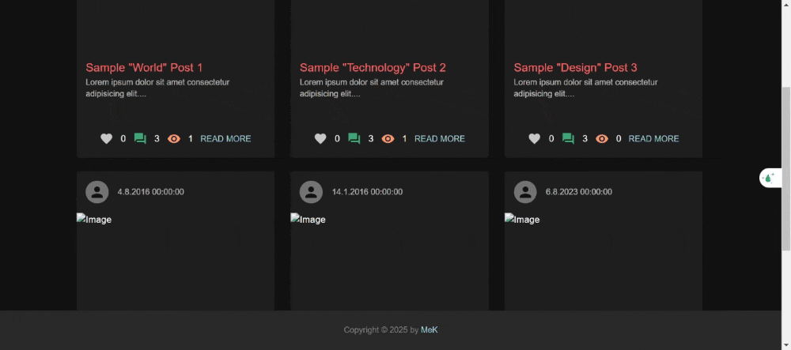

## Blog App Frontend

Die Blog App ist eine moderne Webanwendung, mit der Nutzer Blogs erstellen, bearbeiten, liken und kommentieren können. Die App ist responsiv gestaltet und bietet eine einfache sowie intuitive Benutzererfahrung.

- **Live-Demo:** https://blog-app-murex-two.vercel.app
- **Backend (Node.js / Express / MongoDB):** https://github.com/MuzafferKocak/MyBlogApi

## Features

- Registrieren, Anmelden und Abmelden
- Blogs anzeigen, erstellen, bearbeiten und löschen (nur eigene Beiträge, Admins alle)
- Beiträge liken und Kommentare hinzufügen
- Kategorien und Pagination für eine bessere Übersicht
- Dunkles und helles Design (umschaltbar)
- Moderne UI mit Material UI
- State-Management mit Redux Toolkit

## Technologien

- React
- Redux Toolkit
- Material UI
- Formik / Yup
- Axios

## Lokal starten

### 1. Repository klonen

```bash
git clone https://github.com/muzafferkocak/milestone-blog-app.git
cd milestone-blog-app
```

### 2. Abhängigkeiten installieren

```bash
npm install
```

### 3. Starten

```bash
npm start
```

Die App läuft danach unter http://localhost:3000.
Die Adresse des Backends steht in der Datei `.env` (`REACT_APP_BASE_URL`).


